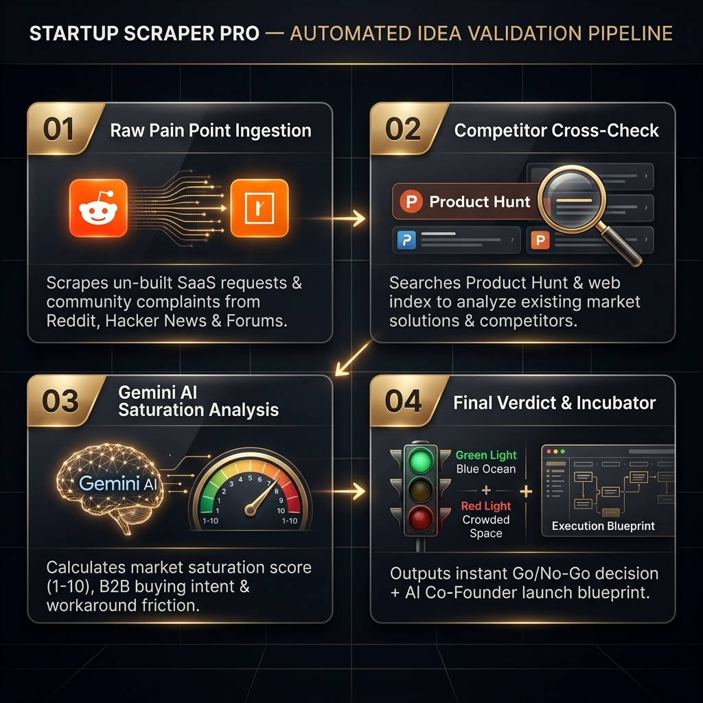

# 🚀 Startup Scraper Pro (Startup Hunt)

> **Uncover your next billion-dollar startup idea** through automated multi-source pain point scraping, AI-driven market saturation scoring, and an interactive AI Co-Founder workspace.

[](https://startup-hunt-v1.web.app)
[](https://nextjs.org/)
[](https://react.dev/)
[](https://tailwindcss.com/)
[](https://ai.google.dev/)
[](LICENSE)

---



## 🌟 Key Features

### 1. 🔍 Multi-Source Pain Point Scraping
Extracts high-intent business opportunities and un-built SaaS complaints in real time across top platform ecosystems:
- **Product Hunt:** GraphQL API integration parsing launch discussions and user complaints.
- **Hacker News:** Algolia REST API search identifying founder grievances and tech friction.
- **Reddit:** Structured JSON scraper targeting subreddits (r/SaaS, r/startups, r/SmallBusiness).
- **Smart India Hackathon (SIH 2024):** Problem statements from Ministries, PSUs, and state governments.
- **iDEX (Defense Innovation Organisation):** Defense and aerospace technology challenges.

---

### 2. 🧠 Map-Cluster-Reduce AI Analysis
Eliminates LLM attention dilution and noise through a structured Map-Reduce pipeline powered by Google Gemini:
- **Signal-to-Noise Filtering:** Evaluates posts against strict Pydantic schemas scoring **workaround friction (1-10)**, **B2B relevance (1-10)**, and **financial loss signals**.
- **Market Saturation Scoring:** Assigns a 1-10 market saturation score based on existing SaaS alternatives.
- **Traffic Light Recommendations:**
  - 🟢 **Green Light (1-4/10):** Blue Ocean / High Opportunity — low direct SaaS competition.
  - 🟡 **Amber Light (5-7/10):** Moderate Competition — differentiated positioning required.
  - 🔴 **Red Light (8-10/10):** Saturated Market — highly crowded space.

---

### 3. 🎠 Interactive Card Showcase & Navigation
- **Horizontal Scroll Carousel:** Browse scraped opportunities with smooth inertia.
- **Left (`<`) & Right (`>`) Arrow Controls:** Explicit navigation buttons cleanly aligned with ZERO header overlap.
- **Mouse Wheel Scroll Conversion:** Vertical mouse wheel movements automatically scroll the carousel horizontally.
- **Auto-Scroll to Start:** Scraping new ideas automatically smooth-scrolls to `scrollLeft = 0` to focus on fresh results immediately.
- **Real-time Local Timestamps:** Displays exact local date/time (`Scraped 10 Aug 2026, 05:42 pm IST`).

---

### 4. 🧪 Startup Incubator Workspace (`/incubator/[id]`)
Transform scraped pain points into launch-ready startups:
- **🤖 AI Co-Founder Chat (`ChatClient.tsx`):** Interactive multi-turn AI consultation providing business models, GTM strategy, tech architecture, and investor pitch deck guidance.
- **🗺️ Execution Blueprint Canvas (`BlueprintCanvas.tsx`):** Node-based visual flowchart canvas (`@xyflow/react`) mapping system architecture, frontend/backend specs, database schema, API contracts, and launch milestones.
- **📱 Dual-Layer Storage Sync:** Synchronizes between SQLite/Turso server database and client `localStorage`, enabling custom scraped ideas to work seamlessly on mobile, desktop, and static hosting platforms.

---

## 🏗️ Architecture Overview

```mermaid
flowchart TD
    subgraph Data Sources
        PH[Product Hunt GraphQL API]
        HN[Hacker News Algolia API]
        RD[Reddit JSON / PRAW API]
        SIH[Smart India Hackathon Parser]
        IDEX[iDEX Defense Innovation Parser]
    end

    subgraph Python Pipeline (pipeline/)
        A[01_ingest_agents.py] -->|Filter Signal/Noise| B[02_ph_market_research.py]
        B -->|Gemini 1.5/2.5 Analysis| C[03_gemini_verdict.py]
        C -->|Save Verdicts| DB[(SQLite / Turso DB)]
    end

    subgraph Frontend App (frontend/)
        UI[Next.js 16 Dashboard] <-->|Sync Storage| LS[localStorage Fallback]
        UI <-->|Fetch / API| DB
        UI -->|Interactive Co-Founder| CHAT[AI Chat Workspace]
        UI -->|Visual Specs| CANVAS[Execution Blueprint Canvas]
    end

    PH --> A
    HN --> A
    RD --> A
    SIH --> A
    IDEX --> A
```

---

## 🛠️ Tech Stack

### **Frontend**
- **Framework:** Next.js 16.3 (Turbopack, Static Export)
- **UI Library:** React 19.2
- **Styling:** Vanilla CSS & TailwindCSS v4 with Glassmorphism aesthetics
- **Animations:** Framer Motion 12, GSAP, Lenis Smooth Scroll
- **Flowchart Canvas:** `@xyflow/react` (React Flow 12)
- **Markdown & Icons:** `react-markdown`, `remark-gfm`, `lucide-react`

### **Backend & AI Pipeline**
- **Language:** Python 3.10+
- **AI Models:** Google Gemini 1.5 Pro/Flash, Gemini 2.5 (`google-genai` SDK)
- **Schema Validation:** Pydantic v2
- **Database:** SQLite / Turso (`sqlmodel`, `@libsql/client`)
- **Web Search & Scraping:** DuckDuckGo Search, PRAW, Custom Parsers

### **Deployment & Cloud**
- **Hosting:** Firebase Hosting (`startup-hunt-v1.web.app`)
- **Build Output:** Next.js Static HTML Export (`output: "export"`)

---

## 📂 Repository Structure

```
.
├── ARCHITECTURE_AND_TEARDOWN.md  # Architectural teardown & signal extraction design
├── firebase.json                 # Firebase Hosting configuration (public: frontend/out)
├── .firebaserc                   # Firebase project mapping (startup-hunt-v1)
├── render.yaml                   # Render deployment configuration
├── requirements.txt              # Python dependencies
├── pipeline/                     # Python data ingestion & AI analysis pipeline
│   ├── 01_ingest_agents.py       # Multi-source scraper (PH, HN, Reddit, SIH, iDEX)
│   ├── 02_ph_market_research.py  # Market saturation & SaaS competitor analyzer
│   └── 03_gemini_verdict.py      # Gemini LLM verdict & traffic-light generator
├── database/                     # SQLite database migrations & schema definitions
│   └── painpoints.db             # Local SQLite database instance
└── frontend/                     # Next.js 16 React Web Application
    ├── src/
    │   ├── app/
    │   │   ├── page.tsx          # Main Scraper Dashboard & Verdict Showcase
    │   │   ├── incubator/        # Incubator Saved Ideas List & Detail Workspace
    │   │   │   └── [id]/         # AI Co-Founder Chat & Blueprint Canvas
    │   │   ├── settings/         # Engine settings & API key management
    │   │   └── sources/          # Data sources configuration
    │   ├── components/
    │   │   ├── VerdictShowcase.tsx # Horizontal carousel with arrow controls
    │   │   ├── EngineControls.tsx  # Hero market target selector & scraper trigger
    │   │   ├── BlueprintCanvas.tsx # Visual node-based execution blueprint
    │   │   └── DashboardLayout.tsx # Glassmorphism navigation layout
    │   └── lib/
    │       ├── clientEngine.ts   # Client-side scraping engine & localStorage sync
    │       └── db.ts             # SQLite & Turso database client
    ├── next.config.ts            # Next.js config (output: export, unoptimized images)
    └── package.json
```

---

## ⚡ Quick Start & Setup

### Prerequisites
- **Node.js:** v18.17+ or v20+
- **Python:** v3.10+
- **Google Gemini API Key:** Get key from [Google AI Studio](https://aistudio.google.com/)

---

### 1. Clone Repository & Install Dependencies

```bash
# Clone the repository
git clone https://github.com/rahulshome121345/Hunt.git
cd Hunt

# Install Python requirements
pip install -r requirements.txt

# Install Frontend dependencies
cd frontend
npm install
```

---

### 2. Environment Variables Setup

Create a `.env` file in the root directory and inside `frontend/.env.local`:

**Root `.env` & `frontend/.env.local`:**
```env
GEMINI_API_KEY=your_gemini_api_key_here
TURSO_DATABASE_URL=file:painpoints.db
TURSO_AUTH_TOKEN=
```

---

### 3. Running the App Locally

#### Start Next.js Development Server:
```bash
cd frontend
npm run dev
```
Open **[http://localhost:3000](http://localhost:3000)** in your browser.

#### Running the Python Ingestion Pipeline:
```bash
# Ingest raw pain points from all sources
python pipeline/01_ingest_agents.py

# Perform market research on extracted ideas
python pipeline/02_ph_market_research.py

# Generate Gemini AI verdicts & recommendations
python pipeline/03_gemini_verdict.py
```

---

## 🧪 Linting, Building & Deployment

### Run ESLint & TypeScript Checks:
```bash
cd frontend
npm run lint
```

### Build Static Export:
```bash
cd frontend
npm run build
```

### Deploy to Firebase Hosting:
```bash
# From workspace root
npx firebase deploy --only hosting
```
Live URL: **[https://startup-hunt-v1.web.app](https://startup-hunt-v1.web.app)**

---

## 📜 License

Distributed under the **MIT License**. See `LICENSE` for details.

---

<p center>
Built with ❤️ using <strong>Next.js 16</strong>, <strong>React 19</strong>, and <strong>Google Gemini AI</strong>.
</p>
